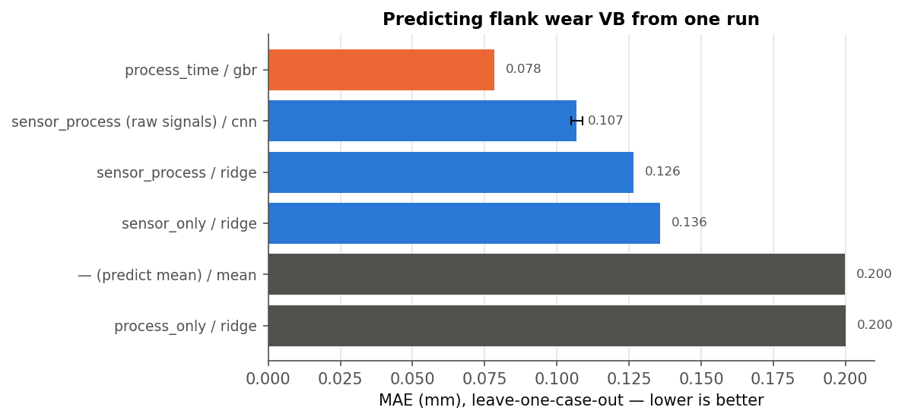

# Tool-Wear Estimation on the NASA Milling Dataset

Estimate the **flank wear VB (mm)** of a face-milling insert from the sensor signals recorded during a
single cutting run: spindle-motor current, vibration, and acoustic emission.

Dataset: A. Agogino & K. Goebel, *Milling Data Set*, NASA Ames Prognostics Data Repository
(documentation in [docs/dataset_readme.pdf](docs/dataset_readme.pdf)).

## Project layout

```
Nasa-milling-wear/
├── configs/
│   └── baseline.yaml          # every experiment setting (window, feature sets, models, CNN hparams)
├── data/
│   ├── raw/                   # mill.mat (+ original mill.zip), never modified
│   └── processed/             # generated: runs.csv, features.csv, signals.npy
├── docs/
│   └── dataset_readme.pdf     # official dataset documentation
├── notebooks/
│   ├── 01_eda.ipynb           # exploratory data analysis (executed, with outputs)
│   ├── 02_simple_demo.ipynb   # start here: short, self-contained demo (7 features, 1 model)
│   └── 03_detailed_results.ipynb  # full results: all models, CNN, error analysis
├── src/milling/               # importable library code
│   ├── data.py                # load .mat, flag corrupt runs, VB interpolation
│   ├── features.py            # steady-state window, time/frequency features
│   ├── models.py              # sklearn baselines + WearCNN (PyTorch)
│   ├── evaluate.py            # leave-one-case-out CV, metrics
│   ├── viz.py                 # result plots
│   └── utils.py               # config, seeding, plot style
├── scripts/                   # entry points (run from the project root)
│   ├── make_dataset.py        # raw -> processed
│   ├── train.py               # classical models, feature-set ablation
│   ├── train_cnn.py           # 1D-CNN on raw signals
│   └── report.py              # results table + headline figures
├── models/                    # generated: saved model(s)
└── reports/
    ├── figures/               # all generated figures (eda_*.png from the notebook)
    └── results/               # metrics CSVs, out-of-fold predictions, summary.md
```

## Reproduce

```bash
pip install -r requirements.txt
```

```bash
python scripts/make_dataset.py && python scripts/train.py && python scripts/train_cnn.py && python scripts/report.py
```

```bash
jupyter nbconvert --to notebook --execute --inplace notebooks/01_eda.ipynb notebooks/02_simple_demo.ipynb notebooks/03_detailed_results.ipynb
```

Full pipeline takes ~3 minutes (CNN on a CUDA GPU; it also runs on CPU, more slowly).
All settings live in `configs/baseline.yaml`; copy it to try a variant and pass `--config`.

## Data at a glance

| | |
|---|---|
| Runs | 167 (16 cases × 1–23 runs); each case = one insert used until worn |
| Design | 2 × 2 × 2 factorial: material (cast iron / steel) × depth of cut (0.75 / 1.5 mm) × feed (0.25 / 0.5 mm/rev), each setting repeated with a 2nd insert |
| Signals | 6 channels (smcAC, smcDC, vib_table, vib_spindle, AE_table, AE_spindle), 250 Hz × 36 s = 9000 samples |
| Target | VB measured after 146 runs; **145 usable** after dropping corrupt runs |

## EDA findings (details in [notebooks/01_eda.ipynb](notebooks/01_eda.ipynb))

1. **Data quality.** Two runs are corrupt and dropped: case 2 run 1 (numeric overflow, values ~1e33) and
   case 12 run 1 (15 360 samples instead of 9000, AE channels all zero). 21 runs have no VB label.
   Case 6 has a single run (VB = 0).
2. **Clipping.** `smcDC` saturates at the ADC ceiling (9.995 V) for up to 72 % of a run under heavy
   cuts, so its amplitude features are capped in exactly the worn and high-load regime.
3. **Wear curves** are monotonic and accelerating. **Material dominates**: steel inserts reach
   VB = 0.3 mm after ~4–15 min, cast iron after ~20–60 min.
4. **Duplicate inserts disagree**: identical settings can give ~2× different wear rates. That
   insert-to-insert variability is why every evaluation here holds out whole cases.
5. **Signal anatomy.** Each record is idle → entry → steady cut → exit. A fixed window of samples
   2000–6500 sits inside the steady cut for 98–100 % of runs; features are computed only there.
6. **Wear signatures.** Spindle-current amplitude has the highest correlation with VB (Spearman ρ ≈ 0.71), for both
   materials. AE rises with wear on cast iron but barely on steel. Vibration RMS *falls* with wear and
   mostly reflects case-to-case offsets. Case 1 has vibration levels outside every other case (a covariate shift).

## Modelling task

**Regression:** one run's signals (+ optionally process parameters) → VB of the insert after that run.

**Validation:** leave-one-case-out CV (16 folds). Every prediction is for an insert the model has never
seen, which is how the model would be used on a new tool. A random split would leak, because consecutive
runs of one insert are almost identical.

**Inputs compared** (ablation):

| Feature set | Contents |
|---|---|
| `process_only` | DOC, feed, material |
| `process_time` | + cumulative cutting time (not sensor-based, reference only) |
| `sensor_only` | 102 hand-crafted features (6 channels × stats, spectral centroid/peak, band powers) |
| `sensor_process` | sensor features + DOC, feed, material |
| raw signals (CNN) | 6 × 4500 steady-state samples + DOC, feed, material |

**Models:** mean predictor, Ridge (quantile-transformed inputs), SVR, Random Forest, Gradient Boosting,
and a 3-block 1D-CNN (`WearCNN`) trained on random 1024-sample crops, with predictions averaged over sliding windows.

## Results

Leave-one-case-out, 145 runs. CNN is mean ± std over 3 seeds. Full table: [reports/results/summary.md](reports/results/summary.md);
walk-through with error analysis: [notebooks/03_detailed_results.ipynb](notebooks/03_detailed_results.ipynb).

| Inputs | Best model | MAE (mm) | RMSE (mm) | R² |
|---|---|---|---|---|
| process + cutting time | GBR | 0.078 | 0.124 | 0.77 |
| **raw signals + process** | **1D-CNN** | **0.107 ± 0.002** | **0.152 ± 0.006** | **0.66 ± 0.03** |
| sensor features + process | Ridge | 0.126 | 0.177 | 0.53 |
| sensor features only | Ridge | 0.136 | 0.204 | 0.38 |
| predict the mean | — | 0.200 | 0.264 | −0.04 |
| process only | Ridge | 0.200 | 0.266 | −0.05 |



**Takeaways**

- Sensors carry real wear information: using them cuts the error by about half compared with the
  mean/process-only baselines (0.20 → 0.107 mm).
- The **CNN on raw signals beats hand-crafted features** (0.107 vs 0.126 mm MAE) and is stable across seeds.
- Adding the process parameters helps every sensor model, because the link between signal and wear
  depends on the material and the cut.
- **Cutting time is still the strongest single input** (0.078 mm). In this lab dataset wear grows
  with time very regularly. Time works as a reference, but it doesn't monitor the tool itself: it
  misses chipping, material inclusions, or a tool with an unknown history.
- **Where it fails:** the model under-predicts very high wear (case 13 above 0.8 mm; see
  `reports/figures/trajectories_cnn.png`). Only two inserts ever get past 1 mm, so the model has
  almost nothing to learn from in that range.

## Next steps

- Fuse sensors **and** time/history (e.g. a sequence model over a case's runs), and check whether the sensors add information on top of time.
- Use interpolated VB labels for training (`data.use_interpolated_vb: true`) to add 13 more labels (+9 %).
- Recast as classification (e.g. VB < 0.2 / 0.2–0.45 / > 0.45 mm) or as remaining-useful-life prediction.
- Handle smcDC clipping explicitly (saturation-fraction feature or drop the channel).
- Hyper-parameter search with nested group CV (the current settings are hand-picked defaults).
